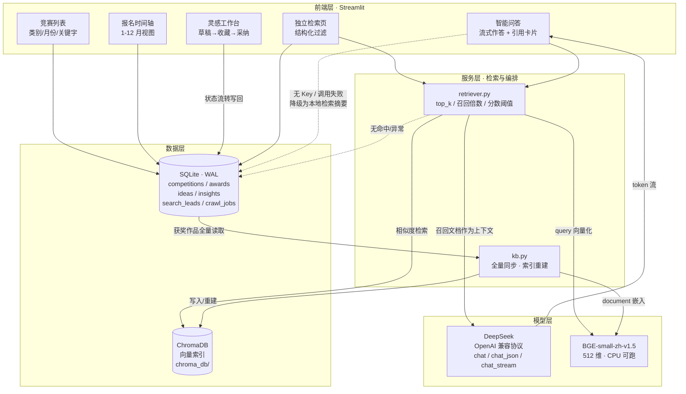

# 🏆 竞赛情报与获奖作品知识库系统

> 一个「结构化检索 + 语义检索（RAG）+ LLM 生成」的竞赛情报工作台：
> 查比赛、看时间轴、问问题、攒灵感，四页搞定。

---
### 首先这个报告是我的agent自己生成的，他根据我创造他的全流程自我总结。原本我只是依据任务一的软件工程流程做了一个很普通的竞赛信息管理，只不过后面想着做一下迭代吧，然后就成了现在这样，这还只是一个半成品，还没做完，还可以做一些迭代。

---

## 系统架构

下图展示三层架构与一次「提问」请求的完整流转路径。实线为同步调用，虚线为降级/重建路径。



**关键设计**：SQLite 是唯一真值源，Chroma 只是可丢弃、可重建的派生索引（图中虚线回边）；DeepSeek 与 BGE 都做了失败降级，任何一环不可用都不会让页面白屏。

---

## 1. 项目简介

面向「选赛 / 备赛 / 找选题」场景的一体化工具。核心解决三个问题：

| 痛点 | 本项目的解法 |
| --- | --- |
| 比赛信息散落在各个官网，报名月份、级别、类别难对齐 | SQLite 结构化真值源 + 列表/时间轴双视图筛选 |
| 想知道「什么样的作品能获奖」，但历史获奖作品没有索引 | 获奖作品入库 → Chroma 向量索引 → 自然语言语义检索 |
| 检索到一堆条目后，还要自己读完再总结 | 检索结果作为参考资料喂给 LLM，直接生成带引用的答案 |

**四个页面**

- **竞赛列表**：类别 / 月份 / 关键字组合筛选，卡片展示，支持排序。
- **报名时间轴**：按 1–12 月查看「本月报名中」与「本月进行中」的赛事。
- **智能问答**：自然语言提问 → 向量召回 → LLM 流式作答，答案下方折叠展示引用来源卡片；**无 Key 或调用异常时自动降级为本地检索摘要**，页面永不白屏。
- **灵感工作台**：LLM 生成的洞察（分类分布 / 趋势 / 选题建议）三 Tab 折叠展示；选题卡片支持 `草稿 → 收藏 → 采纳` 状态流转并写回数据库，顶部指标实时联动。

**独立语义检索页**（`pages/检索.py`）：不经过 LLM 的纯检索视图，带类别/级别/奖项等级/年份区间/仅已审核等结构化过滤，适合做数据核对。

---

## 2. 技术栈

| 层 | 选型 | 说明 |
| --- | --- | --- |
| UI | Streamlit ≥1.36 | 多页面 + 自定义 CSS 卡片样式 |
| 结构化存储 | SQLite（WAL） | `competitions` / `awards` / `ideas` / `insights` / `search_leads` / `crawl_jobs` |
| 向量检索 | ChromaDB + BAAI/bge-small-zh-v1.5（512 维） | 本地持久化，CPU 可跑；模型不可用时自动降级为确定性 mock 向量 |
| LLM | OpenAI 兼容协议（DeepSeek） | 流式输出；Key 走 `.env` |
| 数据处理 | pandas + openpyxl | Excel 批量导入 |
| 后端 API（可选） | 标准库 `http.server` | `api.py` 提供 `/api/competitions`、`/api/timeline` 的 REST 接口，供非 Streamlit 前端调用 |

**设计分工**：SQLite 负责筛选/聚合/统计的「真值」，Chroma 只做语义相似度索引，且**索引可随时由 SQLite 全量重建**。

---

## 3. 目录结构

```
.
├── app.py                  # 主入口（4 页路由 + 全局 CSS + 问答/灵感页实现）
├── api.py                  # 可选：REST 后端（competitions / timeline）
├── db.py                   # SQLite 连接、建表迁移、竞赛 CRUD、awards/leads/ideas/insights 读写
├── schema.sql              # 主表 competitions 结构
├── schema_kb.sql           # 知识库表结构（awards / search_leads / crawl_jobs / insights / ideas）
├── llm.py                  # LLM 封装：chat / chat_json / chat_stream / ping / llm_available / llm_config_hint
├── embedder.py             # 向量化封装（HF 镜像、bge-small-zh、mock 兜底）
├── retriever.py            # Chroma 检索（filters / top_k / 分数阈值 / 召回倍数）
├── kb.py                   # 知识库生命周期：init_kb / 全量同步 / 统计
├── analyzer.py             # 洞察生成（分类分布、年度趋势、选题建议）
├── gen_intro.py            # 赛事一句话简介批量生成
├── import_excel.py         # Excel 导入（比赛.xlsx / 计算机类竞赛.xlsx）
├── migrate_levels.py       # 级别字段历史数据迁移
├── scripts/                # 低频运维脚本（建索引预热 / 造数据 / 迁移，见其 README）
├── pages/
│   └── 检索.py             # 独立语义检索页（带结构化过滤）
├── static/
│   └── bg.mp4              # 页面背景视频
├── .streamlit/
│   └── config.toml         # 主题（浅色 / 蓝）+ client / logger 配置
├── chroma_db/              # 向量库持久化目录（首次运行自动生成）
├── competitions.db         # SQLite 数据库（首次运行自动生成）
├── 比赛.xlsx               # 原始数据样例
├── 计算机类竞赛.xlsx       # 原始数据样例
├── requirements.txt
└── README.md
```

---

## 4. 从零部署（有requirements.txt）

### 4.1 环境要求

- Python **3.10+**（推荐 3.11 / 3.12）
- 内存 ≥ 4 GB（加载 bge-small-zh 约 400 MB；纯 mock 模式 >1 GB 即可）
- 可选 GPU：有则自动用，无则 CPU 正常运行

### 4.2 拉代码 & 建虚拟环境

```bash
git clone <your-repo-url> competition-kb
cd competition-kb

python -m venv venv
# Windows
venv\Scripts\activate
# macOS / Linux
source venv/bin/activate
```

### 4.3 安装依赖

```bash
pip install -r requirements.txt
```

> **torch 体积优化**：只需要 CPU 推理时，先装 CPU 版再装其余依赖
> ```bash
> pip install torch --index-url https://download.pytorch.org/whl/cpu
> pip install -r requirements.txt
> ```
> **国内网络**：向量模型首次运行会从 `hf-mirror.com` 下载（代码内已内置镜像设置），约 100 MB，请保持网络通畅。若下载失败，程序会自动切到 **mock 向量模式**（检索链路仍可跑通，只是语义质量下降），可用环境变量强制：
> ```bash
> set KB_EMBED_MOCK=1        # Windows
> export KB_EMBED_MOCK=1     # macOS / Linux
> ```

### 4.4 配置 `.env`

在项目根目录新建 `.env`：

```dotenv
# ---- LLM（OpenAI 兼容协议）----
DEEPSEEK_API_KEY=sk-xxxxxxxxxxxxxxxxxxxxxxxx
DEEPSEEK_BASE_URL=https://api.deepseek.com
DEEPSEEK_MODEL=deepseek-flash

# ---- 可选：检索参数 ----
# KB_CHROMA_DIR=chroma_db        # 向量库目录
# KB_COLLECTION=awards           # 集合名
# KB_RECALL_MULT=4               # 召回倍数
# KB_MIN_SCORE=0.3               # 最低相似度
# KB_EMBED_MODEL=BAAI/bge-small-zh-v1.5
# KB_EMBED_MOCK=0
```

> ⚠️ `.env` 含密钥，请加入 `.gitignore`，**不要提交到仓库**。
> 不配置 Key 也能启动：问答页会自动走「本地检索摘要」兜底模式。

### 4.5 初始化数据

首次启动会自动建表；如需导入 Excel 原始数据：

```bash
python import_excel.py            # 导入竞赛基础信息
python migrate_levels.py          # 如为老库，补齐 level / level_label
```

构建向量索引（把 SQLite 中的获奖作品同步到 Chroma）：

```bash
python kb.py                      # 或在「检索」页点击"从数据库同步索引"
```

可选：生成赛事一句话简介 / 洞察数据

```bash
python gen_intro.py               # 批量生成 intro
python analyzer.py                # 生成分类分布、年度趋势、选题建议（写入 insights 表）
```

### 4.6 启动

```bash
# Streamlit 主应用
streamlit run app.py
# 默认 http://localhost:8501

# 可选：REST 后端（另开一个终端）
python api.py --host 127.0.0.1 --port 8000
# GET /api/competitions?category=&month=&keyword=
# GET /api/timeline?month=1-12
```

### 4.7 冒烟自检

```bash
python -m py_compile app.py llm.py retriever.py kb.py db.py embedder.py
python test_retriever.py          # 检索链路
python test_app.py                # 页面函数可调用性
```

打开首页后按顺序验证：列表筛选 → 时间轴月份切换 → 问答页提问（观察流式输出 + 引用卡片）→ 灵感工作台点击状态按钮（指标卡数字应变化）。

---

## 5. 常见问题

| 现象 | 原因 / 处理 |
| --- | --- |
| 问答页没有打字机效果，直接出结果 | 未配置 `DEEPSEEK_API_KEY` 或调用失败，已自动降级为本地检索摘要 |
| 检索结果文不对题 | 向量模型未下载成功，走了 mock 向量；检查网络或设置 `HF_ENDPOINT` 镜像 |
| 索引为空提示 | 尚未执行 `kb.py` 同步，或 `chroma_db/` 被清空，重新同步即可 |
| `sqlite3.OperationalError: no such column` | 老库结构过旧，运行 `python migrate_levels.py` 或删除库重建 |
| 中文在 Windows 控制台打印报错 | 控制台编码为 GBK，仅影响日志输出，不影响功能；可 `chcp 65001` |

---

## 6. 免责声明

数据来源于公开渠道，仅供学习与查询参考；LLM 生成内容可能存在偏差，请以赛事官网信息为准。

---

## 7. 三条我踩的坑（复盘记录）

开发过程中真正卡住我、且事后值得写下来的，是下面三件事。每一个都附了「怎么发现的」和「最终怎么解的」。

### 坑 1：HuggingFace 模型下载超时卡死，页面像死机

**现象**：第一次跑 `python kb.py` 构建向量索引，终端停在 `Loading BAAI/bge-small-zh-v1.5` 不动，几分钟后抛 `ReadTimeoutError` / `ConnectionError`。更坑的是在 Streamlit 里触发时，页面没有任何报错，只是一直转圈——用户视角就是「死机」。

**原因**：`huggingface_hub` 默认走 `huggingface.co`，国内网络下 TLS 握手和 LFS 大文件分片下载都会超时。模型约 100 MB，会切成多个分片，只要一片卡住整个加载就阻塞。而且这段代码在 import / 首次调用时同步执行，直接堵死在主线程。

**解决**：在 `embedder.py` 的**最顶部**（`import sentence_transformers` 之前）设置镜像环境变量——这一点很关键，晚一步设置就无效，因为库在 import 时就已经读取了 endpoint：

```python
import os
os.environ.setdefault("HF_ENDPOINT", "https://hf-mirror.com")   # 必须先于 sentence_transformers 导入
```

配合 `HF_HUB_DOWNLOAD_TIMEOUT` 调大超时，并把「下载失败」这一分支用 `try/except` 兜住，降级到**确定性 mock 向量**（用 hash 播种的伪向量）。这样即使模型下载不下来，检索链路依然跑得通、页面依然能用，只是语义质量下降——**把硬失败变成软降级**，比让用户对着转圈干等强得多。

### 坑 2：Agent 命令行工具默认 20 秒超时，长脚本被拦腰打断

**现象**：用命令行工具执行 `pip install`、模型预热、全量建索引这类耗时命令时，大约 20 秒后命令就被强行终止，返回的是「超时」而不是任务本身的报错。最误导的是——**部分**任务其实已经成功写入了数据，我却因为看到超时以为失败，重复跑了好几遍，差点把索引写重。

**原因**：工具层的执行超时默认只有 20 秒，与任务实际需要的时间无关。而长任务往往「前半段慢、后半段快」，被砍在中间时状态是不确定的。

**解决**：分三步走，思路是「**让脚本自己扛住，而不是让调用方等**」。

1. **把耗时操作前置并外置**：模型下载 / 预热用 `scripts/warm_model.py`、`scripts/warm_download.py` 单独跑一次，跑完再进主流程，避免每次启动都等。
2. **让长任务幂等**：同步索引用 `upsert` 而不是 `add`，重复执行结果一致；这样即使被中途打断，重跑也不会产生脏数据。
3. **结果落盘再校验**：验证脚本不靠 stdout（控制台一旦被砍，输出就丢了），而是直接写 UTF-8 结果文件，事后读文件确认——这也是我从「以为失败其实成功」里学到的一课：**不要在同一个超时窗口里既跑任务又验结果**。

### 坑 3：Streamlit 流式输出时，浏览器翻译插件炸出 `removeChild`

**现象**：问答页流式打字机效果一切正常，但只要有用户开着浏览器自动翻译（Chrome 右键「翻译成中文」/ Edge 译成英文），页面就会突然白屏，控制台报：

```
Failed to execute 'removeChild' on 'Node': The node to be removed is not a child of this node.
```

非流式页面完全没这个问题，只在流式 + 翻译同时出现时复现。

**原因**：Streamlit 流式输出是**逐 token 更新同一个占位 `div`** 的文本内容。浏览器翻译插件（Google 翻译）会劫持 DOM，把文本节点替换成自己的 `<font>` 包裹节点。当下一批 token 到达、React 想按原引用移除/更新旧节点时，那个节点已经被插件换掉了——于是 `removeChild` 找不到目标，React 直接抛错并卸载整棵子树，表现为白屏。

**解决**：核心是**别让翻译插件碰流式区域**，同时给渲染兜底。

1. 对流式容器加 `translate="no"` 并配合 `notranslate` class，告诉插件这块不要动：

```python
st.markdown(
    '<div class="stream-area notranslate" translate="no"></div>',
    unsafe_allow_html=True,
)
```

2. 流式过程中**只追加不删除**：避免对已有节点做 replace/remove，减少和插件抢 DOM 的机会。
3. 流式结束、拿到完整文本后**一次性重渲染**成最终 Markdown（引用卡片也在这时挂载），让最终态由我们自己完全接管，而不是停在「被插件改过的中间态」。

这个坑教会我的是：**流式渲染本质是在和第三方 DOM 修改者抢所有权**，凡是有外部脚本（翻译、广告拦截、油猴）可能介入的地方，都要假定 DOM 不完全受控，渲染策略要按这个前提来设计。

---
