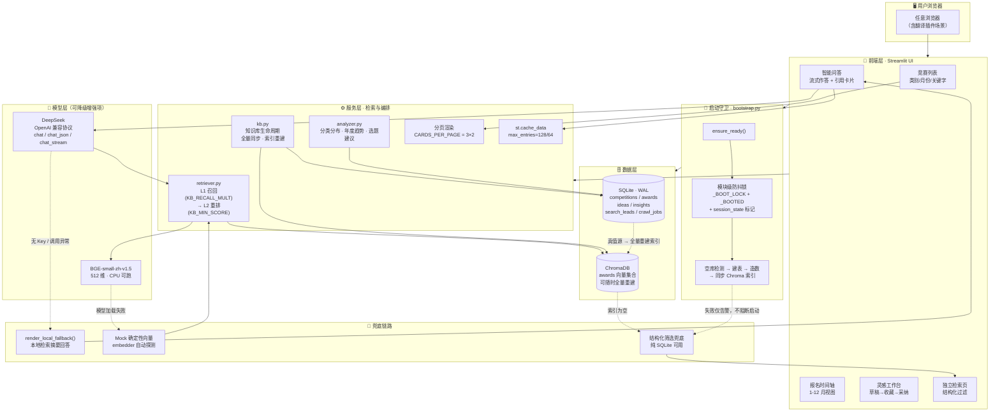

# 🏆 竞赛情报与获奖作品知识库系统

### 首先这个README.md是我用Agent它自己生成的，原本我只是做了一个很普通的比赛信息系统，但是后面又想着做一些迭代，然后就到了现在这样，顺便上了个云端

---
## 线上体验（Live Demo）

> **👉 [https://xiao-666.streamlit.app](https://xiao-666.streamlit.app)**
>
> 打开即用，**无需配置任何 API Key** —— 空库自动建表造数，无 Key 自动降级本地检索摘要，页面永不白屏。

**一句话简介**：把「散落各官网的竞赛信息 + 历史获奖作品」做成一个 **结构化检索 + 语义检索（RAG）+ LLM 生成** 的一体化竞赛情报工作台 —— 查比赛、看时间轴、问问题、攒灵感，四页搞定。

<p align="center">


</p>

---
## 🧭 系统架构

下图是**最全的一张架构图**：包含 Streamlit UI 五大视图、服务层编排、SQLite 真值源、Chroma 向量库、DeepSeek LLM，以及**完整的兜底链路**（虚线）。



**设计分工**：SQLite 负责筛选 / 聚合 / 统计的「真值」，Chroma 只做语义相似度索引，且**索引可随时由 SQLite 全量重建**。

---

## 📖 项目简介

面向「选赛 / 备赛 / 找选题」场景的一体化工具。核心解决三个问题：

| 痛点 | 本项目的解法 |
| --- | --- |
| 比赛信息散落在各个官网，报名月份、级别、类别难对齐 | SQLite 结构化真值源 + 列表/时间轴双视图筛选 |
| 想知道「什么样的作品能获奖」，但历史获奖作品没有索引 | 获奖作品入库 → Chroma 向量索引 → 自然语言语义检索 |
| 检索到一堆条目后，还要自己读完再总结 | 检索结果作为参考资料喂给 LLM，直接生成带引用的答案 |

**四个页面**

- **竞赛列表**：类别 / 月份 / 关键字组合筛选，卡片展示，支持排序；**分页渲染 + 查询缓存**。
- **报名时间轴**：按 1–12 月查看「本月报名中」与「本月进行中」的赛事。
- **智能问答**：自然语言提问 → 向量召回 → LLM 流式作答，答案下方折叠展示引用来源卡片；**无 Key 或调用异常时自动降级为本地检索摘要**，页面永不白屏。
- **灵感工作台**：LLM 生成的洞察（分类分布 / 趋势 / 选题建议）三 Tab 折叠展示；选题卡片支持 `草稿 → 收藏 → 采纳` 状态流转并写回数据库，顶部指标实时联动。

**独立语义检索页**（`pages/检索.py`）：不经过 LLM 的纯检索视图，带类别/级别/奖项等级/年份区间/仅已审核等结构化过滤，适合做数据核对。

---

## 🛠 技术栈

| 层 | 选型 | 说明 |
| --- | --- | --- |
| UI | Streamlit ≥1.36 | 多页面 + 自定义 CSS 卡片样式 |
| 结构化存储 | SQLite（WAL） | `competitions` / `awards` / `ideas` / `insights` / `search_leads` / `crawl_jobs` |
| 向量检索 | ChromaDB + BAAI/bge-small-zh-v1.5（512 维） | 本地持久化，CPU 可跑；模型不可用时自动降级为确定性 mock 向量 |
| LLM | OpenAI 兼容协议（DeepSeek） | 流式输出；Key 走 `.env` |
| 数据处理 | pandas + openpyxl | Excel 批量导入 |
| 后端 API（可选） | 标准库 `http.server` | `api.py` 提供 `/api/competitions`、`/api/timeline` 的 REST 接口，供非 Streamlit 前端调用 |
| 部署 | Streamlit Community Cloud | 空库冷启动自动初始化 + 无 Key 兜底降级 |

---

## 📁 目录结构

```
.
├── app.py                  # 主入口（4 页路由 + 全局 CSS + 问答/灵感页实现）
├── bootstrap.py            # 云端冷启动：空库检测 → 建表 → 造数 → 同步索引（含防抖锁）
├── api.py                  # 可选：REST 后端（competitions / timeline）
├── db.py                   # SQLite 连接、建表迁移、竞赛 CRUD、awards/leads/ideas/insights 读写
├── schema.sql              # 主表 competitions 结构
├── schema_kb.sql           # 知识库表结构（awards / search_leads / crawl_jobs / insights / ideas）
├── llm.py                  # LLM 封装：chat / chat_json / chat_stream / ping / llm_available / llm_config_hint
├── embedder.py             # 向量化封装（HF 镜像、bge-small-zh、mock 兜底）
├── retriever.py            # Chroma 检索（filters / top_k / 分数阈值 / 召回倍数 / L1→L2 两阶段）
├── kb.py                   # 知识库生命周期：init_kb / 全量同步 / 统计
├── analyzer.py             # 洞察生成：分类分布 / 年度趋势 / 选题建议
├── seed_data.py            # 演示数据（冷启动造数来源）
├── pages/                  # 多页面（检索页等）
├── scripts/                # 数据导入 / 迁移 / 生成等辅助脚本
├── static/                 # 静态资源（样式等）
├── test_*.py               # 自测脚本（retriever / pagination / pages / e2e …）
├── CODE_REVIEW.md          # 🔍 代码审查记录（四维度清单 + 问题闭环）
└── README.md
```

---

## ✅ 工程规范

本项目在交付前完成了一轮**系统性代码审查**，覆盖 `安全性 / 健壮性 / 性能 / 代码整洁度` 四个维度，并逐条记录了「发现的问题 → 修改记录 → 遗留项」。

👉 **完整审查记录见：[CODE_REVIEW.md](./CODE_REVIEW.md)**

审查中形成并落地的关键约定：

- **密钥零入库**：`.env` 强制加入 `.gitignore`，代码中只经 `os.getenv` 读取，缺失时走降级而非崩溃。
- **不可信输入先校验**：所有 SQL 走参数化；分页 / top_k / 月份等数值参数做范围钳制。
- **失败可观测**：降级路径必须给出**人能看懂的原因**（如「未检测到 DEEPSEEK_API_KEY，将使用本地检索摘要兜底」）。
- **写操作有守卫**：初始化、索引同步等重操作加锁 + 幂等标记，杜绝重复执行。

---

## 🚀 从零部署（本地）

### 4.1 环境要求

- Python 3.10+
- 可访问 HuggingFace（或配置镜像 `HF_ENDPOINT`）

### 4.2 拉代码 & 建虚拟环境

```bash
git clone <your-repo-url>
cd <repo>
python -m venv venv
# Windows
venv\Scripts\activate
# macOS / Linux
source venv/bin/activate
```

### 4.3 安装依赖

```bash
pip install -r requirements.txt
```

### 4.4 配置 `.env`

```bash
# ---- 必选：LLM ----
DEEPSEEK_API_KEY=sk-xxxxxxxxxxxxxxxx
DEEPSEEK_BASE_URL=https://api.deepseek.com
DEEPSEEK_MODEL=deepseek-chat

# ---- 可选：检索参数 ----
# KB_CHROMA_DIR=chroma_db        # 向量库目录
# KB_COLLECTION=awards           # 集合名
# KB_RECALL_MULT=4               # 召回倍数
# KB_MIN_SCORE=0.3               # 最低相似度
# KB_EMBED_MODEL=BAAI/bge-small-zh-v1.5
# KB_EMBED_MOCK=0
```

> ⚠️ `.env` 含密钥，请加入 `.gitignore`，**不要提交到仓库**。
> **不配置 Key 也能启动**：问答页会自动走「本地检索摘要」兜底模式。

### 4.5 初始化数据

首次启动会**自动建表**；如需导入 Excel 原始数据（以下脚本均位于项目根目录）：

```bash
python import_excel.py            # 导入竞赛基础信息
python migrate_levels.py          # 如为老库，补齐 level / level_label
```

构建向量索引（把 SQLite 中的获奖作品同步到 Chroma）：

```bash
python kb.py                      # 或在「检索」页点击"从数据库同步索引"
```

可选：生成赛事一句话简介 / 洞察数据

```bash
python gen_intro.py               # 批量生成 intro
python analyzer.py                # 生成分类分布、年度趋势、选题建议（写入 insights 表）
```

### 4.6 启动

```bash
# Streamlit 主应用
streamlit run app.py
# 默认 http://localhost:8501

# 可选：REST 后端（另开一个终端）
python api.py --host 127.0.0.1 --port 8000
# GET /api/competitions?category=&month=&keyword=
# GET /api/timeline?month=1-12
```

### 4.7 冒烟自检

```bash
python -m py_compile app.py llm.py retriever.py kb.py db.py embedder.py bootstrap.py
python test_retriever.py          # 检索链路
python test_pagination.py         # 分页逻辑
python test_app.py                # 页面函数可导入性
```

打开页面顺次验证：列表筛选 → 时间轴月份切换 → 问答页提问（观察流式输出 + 引用卡片）→ 灵感工作台卡片状态按钮与指标卡联动。

---

## ❓ 常见问题

| 现象 | 原因 / 处理 |
| --- | --- |
| 问答页没有打字机效果，直接出结果 | 未配置 `DEEPSEEK_API_KEY` 或调用失败，属**预期降级**：自动转为本地检索摘要 |
| 检索结果相关性差 | 向量模块未加载成功，走了 mock 向量；检查 `HF_ENDPOINT` 或配置镜像 |
| 页面提示索引为空 | 尚未执行 `kb.py` 同步，或 `chroma_db/` 为空；去「检索」页点“从数据库同步索引” |
| `sqlite3.OperationalError: no such column` | 老库结构残留，执行迁移脚本或删除本地库后重启（云端会自动重建） |
| Windows 控制台中文乱码 | 控制台编码为 GBK，不影响功能；可执行 `chcp 65001` |
| 云端首次打开较慢 | 属冷启动：建表 + 造数 + 建索引一次完成，之后走缓存与幂等标记 |
| 流式输出时页面白屏（开了浏览器翻译） | 见下方「坑 3」，已通过 `translate="no"` 与结束态重渲染修复 |

---

## ⚖️ 免责声明

数据来源于公开渠道，仅供学习与查询参考；LLM 生成内容可能存在偏差，请以赛事官方最新公告信息为准。

---

## 🕳 三条我踩的坑（复盘记录）

### 坑 1：HuggingFace 模型下载超时卡死，页面像死机

**现象**：首次启动后访问问答 / 检索页，页面一直转圈，长时间无响应，日志停在模型下载处。

**原因**：默认从 `huggingface.co` 拉取 `bge-small-zh-v1.5`，网络受限时连接一直挂起，而调用方是同步等待，整个页面就被拖住。

**解决**：

1. 配置镜像端点：`HF_ENDPOINT=https://hf-mirror.com`。
2. 在 `embedder.py` 里做**后端探测 + 自动降级**：真模型加载失败立即切到**确定性 mock 向量**（`_mock_vec`，基于文本 md5 生成稳定向量），保证链路不阻塞、结果可复现。
3. 通过 `KB_EMBED_MOCK=1` 可强制走 mock，方便在无网环境下演示与测试。

学到的一课：**凡是「外部资源首次加载」的环节，都必须有超时与降级，否则一次网络抖动就是一次白屏。**

### 坑 2：Agent 命令行工具默认 20 秒超时，长脚本被拦腰打断

**现象**：跑数据导入 / 索引重建时，命令在 20 秒左右被中断，但事后检查数据库发现数据其实已经写进去了——「以为失败，其实成功」。

**原因**：命令行工具默认有 ~20s 超时，超时即杀进程；而脚本的写入是分批提交的，被杀时已提交的部分不会回滚。

**解决**：

1. 长任务显式加大超时，并且**不在超时窗口内做校验**。
2. 改为「先启动、后台跑、结果落文件」，事后再读文件确认结果。
3. 脚本层面保证**幂等**（重复执行不产生重复数据），这样即使被打断也能安全重跑。

这也是我从「以为失败其实成功」里学到的一课：**不要在同一个超时窗口里既跑任务又验结果**。

### 坑 3：Streamlit 流式输出时，浏览器翻译插件炸出 `removeChild`

**现象**：问答页流式打字机效果一切正常，但只要有用户开着浏览器自动翻译（Chrome 右键「翻译成中文」/ Edge 译成英文），页面就会突然白屏，控制台报：

```
Failed to execute 'removeChild' on 'Node': The node to be removed is not a child of this node.
```

非流式页面完全没这个问题，只在流式 + 翻译同时出现时复现。

**原因**：Streamlit 流式输出是**逐 token 更新同一个占位 `div`** 的文本内容。浏览器翻译插件（Google 翻译）会劫持 DOM，把文本节点替换成自己的 `<font>` 包裹节点。当下一批 token 到达、React 想按原引用移除/更新旧节点时，那个节点已经被插件换掉了——于是 `removeChild` 找不到目标，React 直接抛错并卸载整棵子树，表现为白屏。

**解决**：核心是**别让翻译插件碰流式区域**，同时给渲染兜底。

1. 对流式容器加 `translate="no"` 并配合 `notranslate` class，告诉插件这块不要动：

```python
st.markdown(
    '<div class="stream-area notranslate" translate="no"></div>',
    unsafe_allow_html=True,
)
```

2. 流式过程中**只追加不删除**：避免对已有节点做 replace/remove，减少和插件抢 DOM 的机会。
3. 流式结束、拿到完整文本后**一次性重渲染**成最终 Markdown（引用卡片也在这时挂载），让最终态由我们自己完全接管，而不是停在「被插件改过的中间态」。

这个坑教会我的是：**流式渲染本质是在和第三方 DOM 修改者抢所有权**，凡是有外部脚本（翻译、广告拦截、油猴）可能介入的地方，都要假定 DOM 不完全受控，渲染策略要按这个前提来设计。

---
